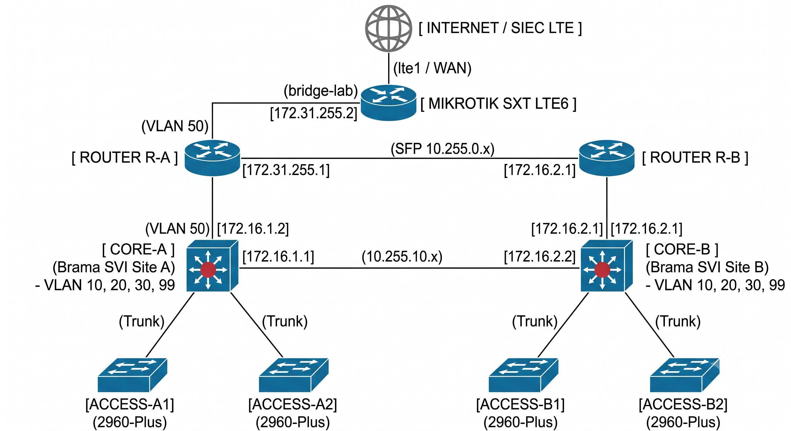

# Enterprise Campus Network Design 🏢

This repository contains a comprehensive computer network design for a medium-sized enterprise, created as part of a network engineering project. 

📄 **[Read the full Project Documentation (PDF)](./Enterprise_network_Mikrotik.pdf)**

## 🗺️ Network Topology

## 🎯 Project Overview
The goal of this project was to design a highly available, secure, and scalable network infrastructure for a company with multiple departments.

## 🛠️ Technologies & Protocols Used
* **Routing:** OSPFv2, Static Routing
* **Switching:** VLANs, Trunking (802.1q), STP (Spanning Tree Protocol)
* **Security:** Standard/Extended ACLs, Port Security
* **Services:** DHCP, NAT/PAT
* **Hardware:** Cisco IOS (Catalyst 2960-Plus, 891F), MikroTik RouterOS (SXT LTE6)

